# Blinded Electrophysiologist ECG Adjudication Packet

**Prepared for:** Dr. Christopher Cheung (Cardiac Electrophysiology Review)
**Cases Included:** 24 blinded rhythm-transition strips (`[-12 s, +18 s]` around annotated AF termination `t = 0 s`, single surface ECG lead, bandpass filtered 0.5–35 Hz)
**Blinding:** Cohort source, patient identifier, upstream rhythm label, and downstream reinitiation timing are completely withheld from all strip images and the adjudication sheet (`ep_review_sheet.csv`).

## Adjudication Instructions
For each strip (`EP_01` through `EP_24`), classify:
1. **`adjudicated_post_rhythm`** (select one):
   - `CONFIRMED_SINUS`: Clear sinus P waves / regular sinus rhythm restored after `t = 0 s`
   - `NON_SINUS_ATRIAL_AFL_AT`: Organized atrial arrhythmia (atrial flutter or atrial tachycardia) without sinus restoration
   - `VENTRICULAR_ECTOPIC_NO_SINUS_RESTORATION`: Ventricular rhythm, bigeminy/trigeminy, or ectopy interruption while underlying atrial fibrillation likely persists
   - `ARTIFACT_OR_NOISE`: Signal dropout, motion artifact, or baseline shift mimicking rhythm transition
   - `INDETERMINATE`: Cannot reliably determine post-transition rhythm from available single-lead strip
2. **`genuine_af_termination`** (`YES`, `NO`, or `INDETERMINATE`)
3. **`reviewer_confidence_1_to_3`** (`1` = low, `2` = moderate, `3` = high)

---

## Blinded ECG Strips

### EP_01
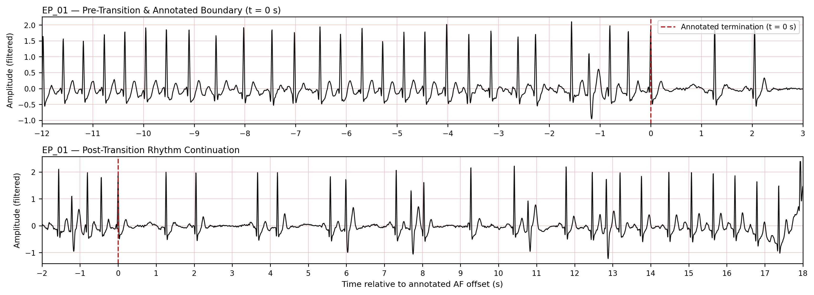
- `adjudicated_post_rhythm`: `[ ] CONFIRMED_SINUS  [ ] NON_SINUS_ATRIAL_AFL_AT  [ ] VENTRICULAR_ECTOPIC_NO_SINUS_RESTORATION  [ ] ARTIFACT_OR_NOISE  [ ] INDETERMINATE`
- `genuine_af_termination`: `[ ] YES  [ ] NO  [ ] INDETERMINATE` | Confidence (`1–3`): `___` | Notes: `________________________`

### EP_02
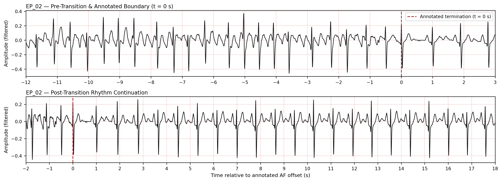
- `adjudicated_post_rhythm`: `[ ] CONFIRMED_SINUS  [ ] NON_SINUS_ATRIAL_AFL_AT  [ ] VENTRICULAR_ECTOPIC_NO_SINUS_RESTORATION  [ ] ARTIFACT_OR_NOISE  [ ] INDETERMINATE`
- `genuine_af_termination`: `[ ] YES  [ ] NO  [ ] INDETERMINATE` | Confidence (`1–3`): `___` | Notes: `________________________`

### EP_03
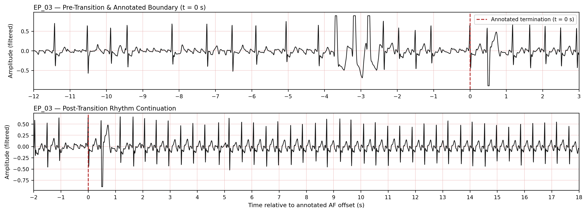
- `adjudicated_post_rhythm`: `[ ] CONFIRMED_SINUS  [ ] NON_SINUS_ATRIAL_AFL_AT  [ ] VENTRICULAR_ECTOPIC_NO_SINUS_RESTORATION  [ ] ARTIFACT_OR_NOISE  [ ] INDETERMINATE`
- `genuine_af_termination`: `[ ] YES  [ ] NO  [ ] INDETERMINATE` | Confidence (`1–3`): `___` | Notes: `________________________`

### EP_04
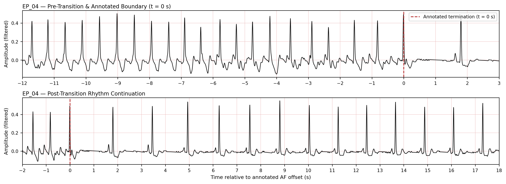
- `adjudicated_post_rhythm`: `[ ] CONFIRMED_SINUS  [ ] NON_SINUS_ATRIAL_AFL_AT  [ ] VENTRICULAR_ECTOPIC_NO_SINUS_RESTORATION  [ ] ARTIFACT_OR_NOISE  [ ] INDETERMINATE`
- `genuine_af_termination`: `[ ] YES  [ ] NO  [ ] INDETERMINATE` | Confidence (`1–3`): `___` | Notes: `________________________`

### EP_05
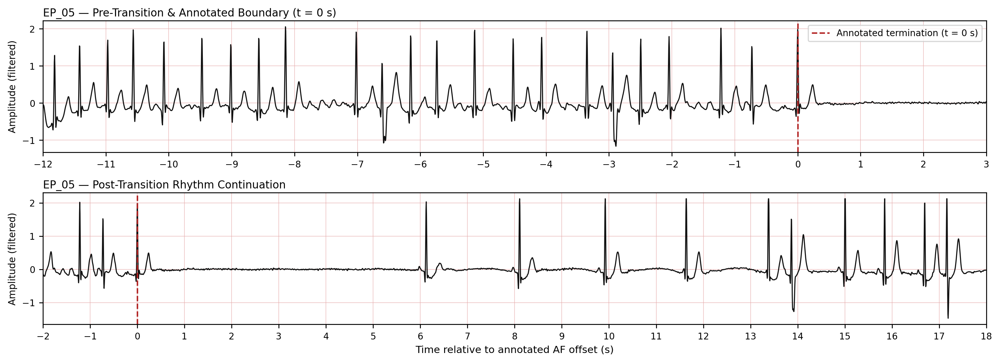
- `adjudicated_post_rhythm`: `[ ] CONFIRMED_SINUS  [ ] NON_SINUS_ATRIAL_AFL_AT  [ ] VENTRICULAR_ECTOPIC_NO_SINUS_RESTORATION  [ ] ARTIFACT_OR_NOISE  [ ] INDETERMINATE`
- `genuine_af_termination`: `[ ] YES  [ ] NO  [ ] INDETERMINATE` | Confidence (`1–3`): `___` | Notes: `________________________`

### EP_06
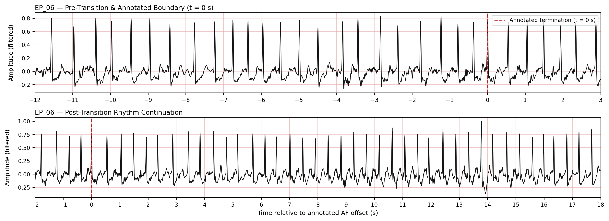
- `adjudicated_post_rhythm`: `[ ] CONFIRMED_SINUS  [ ] NON_SINUS_ATRIAL_AFL_AT  [ ] VENTRICULAR_ECTOPIC_NO_SINUS_RESTORATION  [ ] ARTIFACT_OR_NOISE  [ ] INDETERMINATE`
- `genuine_af_termination`: `[ ] YES  [ ] NO  [ ] INDETERMINATE` | Confidence (`1–3`): `___` | Notes: `________________________`

### EP_07
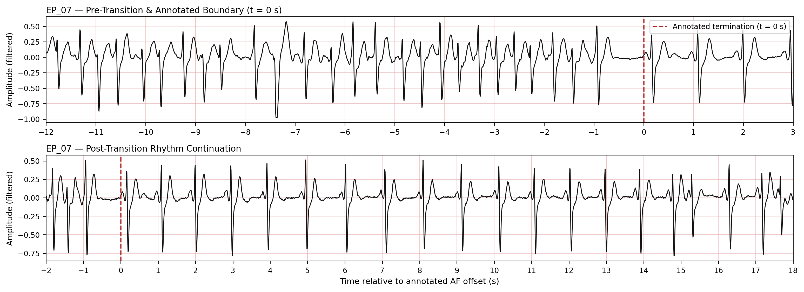
- `adjudicated_post_rhythm`: `[ ] CONFIRMED_SINUS  [ ] NON_SINUS_ATRIAL_AFL_AT  [ ] VENTRICULAR_ECTOPIC_NO_SINUS_RESTORATION  [ ] ARTIFACT_OR_NOISE  [ ] INDETERMINATE`
- `genuine_af_termination`: `[ ] YES  [ ] NO  [ ] INDETERMINATE` | Confidence (`1–3`): `___` | Notes: `________________________`

### EP_08
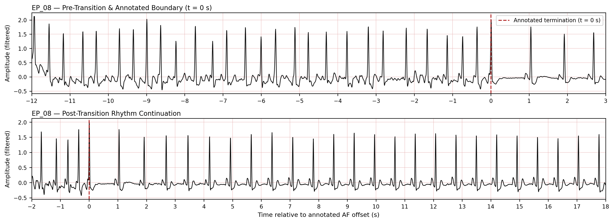
- `adjudicated_post_rhythm`: `[ ] CONFIRMED_SINUS  [ ] NON_SINUS_ATRIAL_AFL_AT  [ ] VENTRICULAR_ECTOPIC_NO_SINUS_RESTORATION  [ ] ARTIFACT_OR_NOISE  [ ] INDETERMINATE`
- `genuine_af_termination`: `[ ] YES  [ ] NO  [ ] INDETERMINATE` | Confidence (`1–3`): `___` | Notes: `________________________`

### EP_09
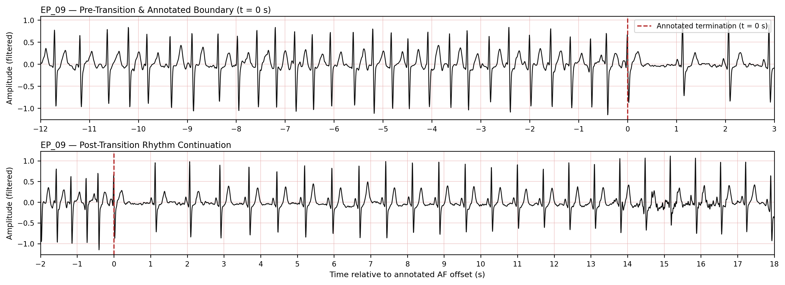
- `adjudicated_post_rhythm`: `[ ] CONFIRMED_SINUS  [ ] NON_SINUS_ATRIAL_AFL_AT  [ ] VENTRICULAR_ECTOPIC_NO_SINUS_RESTORATION  [ ] ARTIFACT_OR_NOISE  [ ] INDETERMINATE`
- `genuine_af_termination`: `[ ] YES  [ ] NO  [ ] INDETERMINATE` | Confidence (`1–3`): `___` | Notes: `________________________`

### EP_10
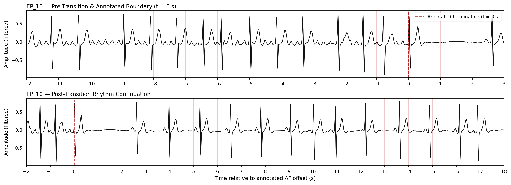
- `adjudicated_post_rhythm`: `[ ] CONFIRMED_SINUS  [ ] NON_SINUS_ATRIAL_AFL_AT  [ ] VENTRICULAR_ECTOPIC_NO_SINUS_RESTORATION  [ ] ARTIFACT_OR_NOISE  [ ] INDETERMINATE`
- `genuine_af_termination`: `[ ] YES  [ ] NO  [ ] INDETERMINATE` | Confidence (`1–3`): `___` | Notes: `________________________`

### EP_11
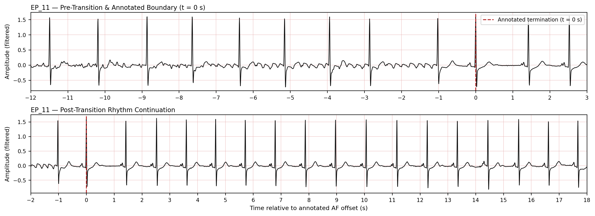
- `adjudicated_post_rhythm`: `[ ] CONFIRMED_SINUS  [ ] NON_SINUS_ATRIAL_AFL_AT  [ ] VENTRICULAR_ECTOPIC_NO_SINUS_RESTORATION  [ ] ARTIFACT_OR_NOISE  [ ] INDETERMINATE`
- `genuine_af_termination`: `[ ] YES  [ ] NO  [ ] INDETERMINATE` | Confidence (`1–3`): `___` | Notes: `________________________`

### EP_12
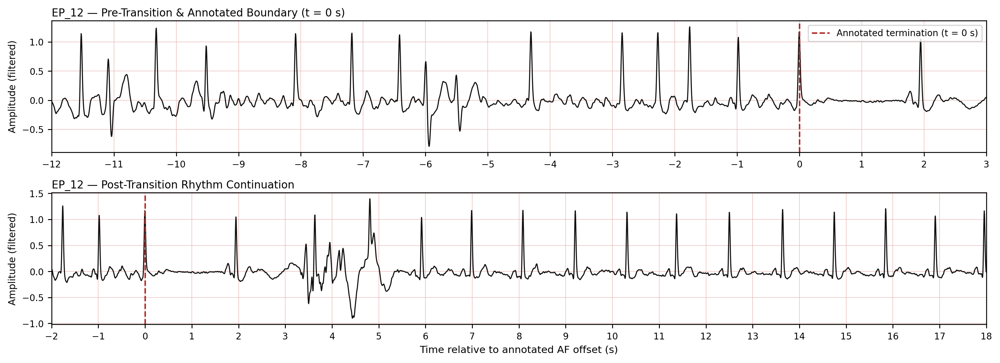
- `adjudicated_post_rhythm`: `[ ] CONFIRMED_SINUS  [ ] NON_SINUS_ATRIAL_AFL_AT  [ ] VENTRICULAR_ECTOPIC_NO_SINUS_RESTORATION  [ ] ARTIFACT_OR_NOISE  [ ] INDETERMINATE`
- `genuine_af_termination`: `[ ] YES  [ ] NO  [ ] INDETERMINATE` | Confidence (`1–3`): `___` | Notes: `________________________`

### EP_13
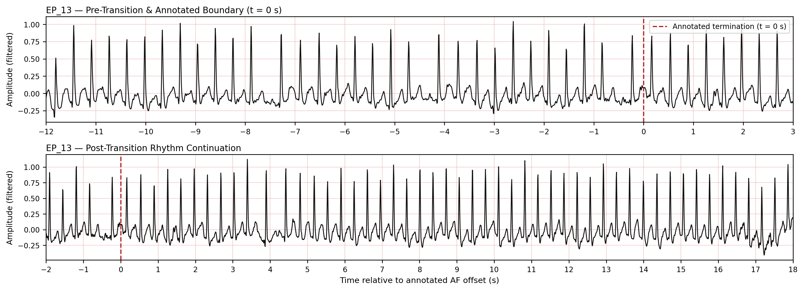
- `adjudicated_post_rhythm`: `[ ] CONFIRMED_SINUS  [ ] NON_SINUS_ATRIAL_AFL_AT  [ ] VENTRICULAR_ECTOPIC_NO_SINUS_RESTORATION  [ ] ARTIFACT_OR_NOISE  [ ] INDETERMINATE`
- `genuine_af_termination`: `[ ] YES  [ ] NO  [ ] INDETERMINATE` | Confidence (`1–3`): `___` | Notes: `________________________`

### EP_14
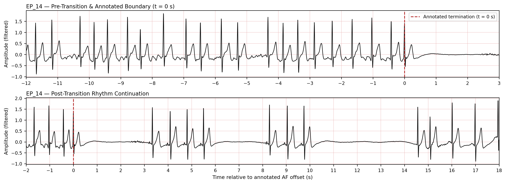
- `adjudicated_post_rhythm`: `[ ] CONFIRMED_SINUS  [ ] NON_SINUS_ATRIAL_AFL_AT  [ ] VENTRICULAR_ECTOPIC_NO_SINUS_RESTORATION  [ ] ARTIFACT_OR_NOISE  [ ] INDETERMINATE`
- `genuine_af_termination`: `[ ] YES  [ ] NO  [ ] INDETERMINATE` | Confidence (`1–3`): `___` | Notes: `________________________`

### EP_15
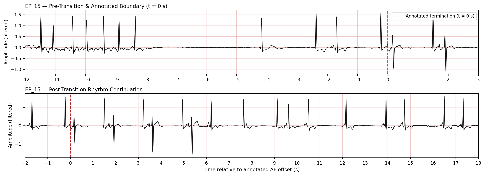
- `adjudicated_post_rhythm`: `[ ] CONFIRMED_SINUS  [ ] NON_SINUS_ATRIAL_AFL_AT  [ ] VENTRICULAR_ECTOPIC_NO_SINUS_RESTORATION  [ ] ARTIFACT_OR_NOISE  [ ] INDETERMINATE`
- `genuine_af_termination`: `[ ] YES  [ ] NO  [ ] INDETERMINATE` | Confidence (`1–3`): `___` | Notes: `________________________`

### EP_16
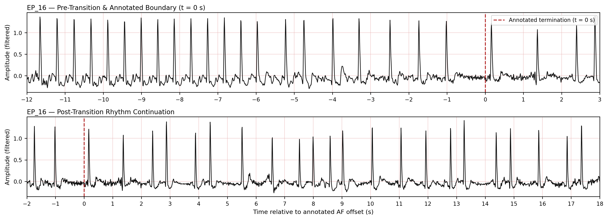
- `adjudicated_post_rhythm`: `[ ] CONFIRMED_SINUS  [ ] NON_SINUS_ATRIAL_AFL_AT  [ ] VENTRICULAR_ECTOPIC_NO_SINUS_RESTORATION  [ ] ARTIFACT_OR_NOISE  [ ] INDETERMINATE`
- `genuine_af_termination`: `[ ] YES  [ ] NO  [ ] INDETERMINATE` | Confidence (`1–3`): `___` | Notes: `________________________`

### EP_17
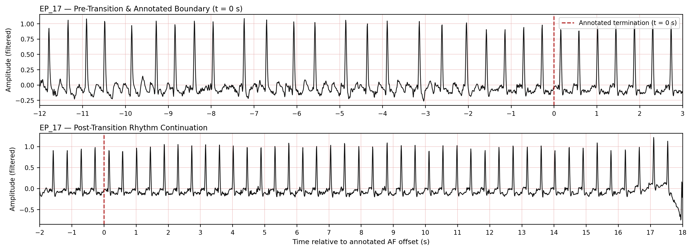
- `adjudicated_post_rhythm`: `[ ] CONFIRMED_SINUS  [ ] NON_SINUS_ATRIAL_AFL_AT  [ ] VENTRICULAR_ECTOPIC_NO_SINUS_RESTORATION  [ ] ARTIFACT_OR_NOISE  [ ] INDETERMINATE`
- `genuine_af_termination`: `[ ] YES  [ ] NO  [ ] INDETERMINATE` | Confidence (`1–3`): `___` | Notes: `________________________`

### EP_18
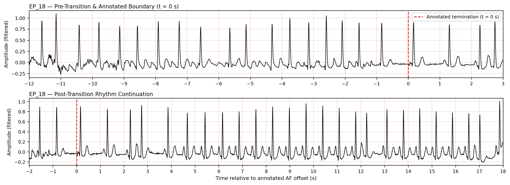
- `adjudicated_post_rhythm`: `[ ] CONFIRMED_SINUS  [ ] NON_SINUS_ATRIAL_AFL_AT  [ ] VENTRICULAR_ECTOPIC_NO_SINUS_RESTORATION  [ ] ARTIFACT_OR_NOISE  [ ] INDETERMINATE`
- `genuine_af_termination`: `[ ] YES  [ ] NO  [ ] INDETERMINATE` | Confidence (`1–3`): `___` | Notes: `________________________`

### EP_19
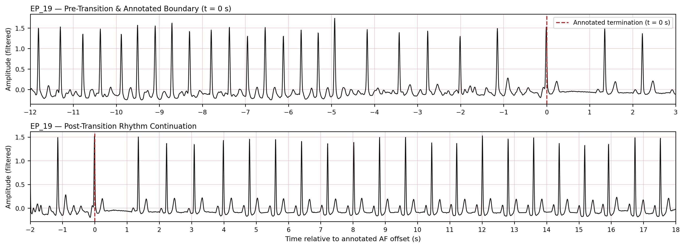
- `adjudicated_post_rhythm`: `[ ] CONFIRMED_SINUS  [ ] NON_SINUS_ATRIAL_AFL_AT  [ ] VENTRICULAR_ECTOPIC_NO_SINUS_RESTORATION  [ ] ARTIFACT_OR_NOISE  [ ] INDETERMINATE`
- `genuine_af_termination`: `[ ] YES  [ ] NO  [ ] INDETERMINATE` | Confidence (`1–3`): `___` | Notes: `________________________`

### EP_20
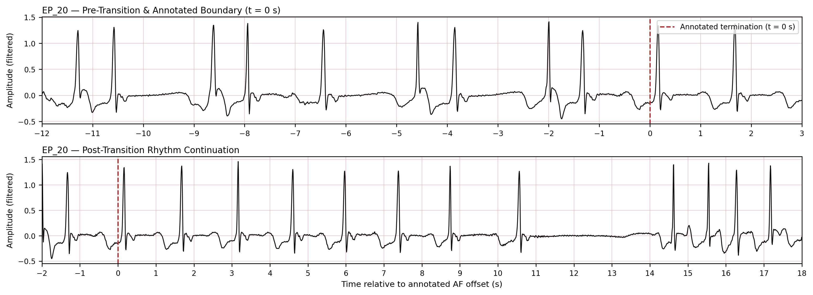
- `adjudicated_post_rhythm`: `[ ] CONFIRMED_SINUS  [ ] NON_SINUS_ATRIAL_AFL_AT  [ ] VENTRICULAR_ECTOPIC_NO_SINUS_RESTORATION  [ ] ARTIFACT_OR_NOISE  [ ] INDETERMINATE`
- `genuine_af_termination`: `[ ] YES  [ ] NO  [ ] INDETERMINATE` | Confidence (`1–3`): `___` | Notes: `________________________`

### EP_21
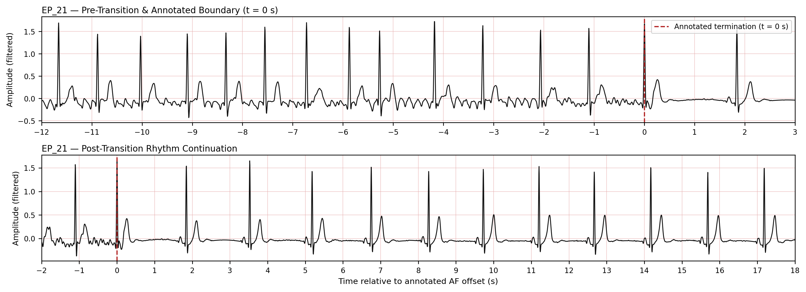
- `adjudicated_post_rhythm`: `[ ] CONFIRMED_SINUS  [ ] NON_SINUS_ATRIAL_AFL_AT  [ ] VENTRICULAR_ECTOPIC_NO_SINUS_RESTORATION  [ ] ARTIFACT_OR_NOISE  [ ] INDETERMINATE`
- `genuine_af_termination`: `[ ] YES  [ ] NO  [ ] INDETERMINATE` | Confidence (`1–3`): `___` | Notes: `________________________`

### EP_22
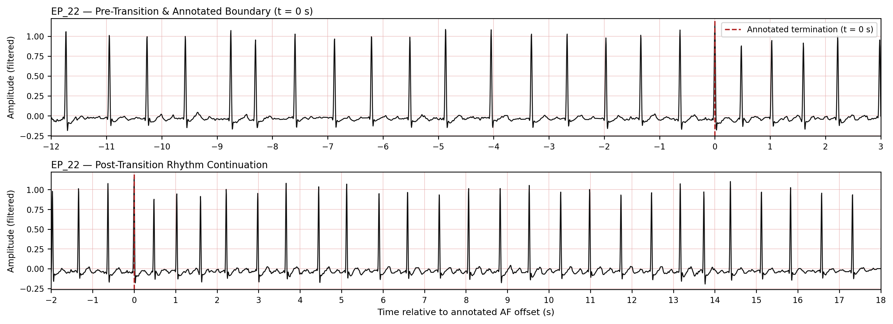
- `adjudicated_post_rhythm`: `[ ] CONFIRMED_SINUS  [ ] NON_SINUS_ATRIAL_AFL_AT  [ ] VENTRICULAR_ECTOPIC_NO_SINUS_RESTORATION  [ ] ARTIFACT_OR_NOISE  [ ] INDETERMINATE`
- `genuine_af_termination`: `[ ] YES  [ ] NO  [ ] INDETERMINATE` | Confidence (`1–3`): `___` | Notes: `________________________`

### EP_23
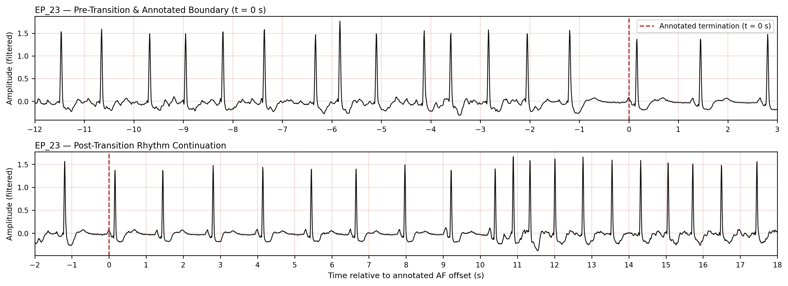
- `adjudicated_post_rhythm`: `[ ] CONFIRMED_SINUS  [ ] NON_SINUS_ATRIAL_AFL_AT  [ ] VENTRICULAR_ECTOPIC_NO_SINUS_RESTORATION  [ ] ARTIFACT_OR_NOISE  [ ] INDETERMINATE`
- `genuine_af_termination`: `[ ] YES  [ ] NO  [ ] INDETERMINATE` | Confidence (`1–3`): `___` | Notes: `________________________`

### EP_24
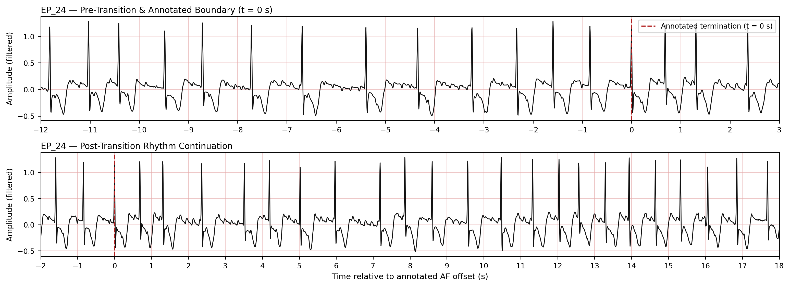
- `adjudicated_post_rhythm`: `[ ] CONFIRMED_SINUS  [ ] NON_SINUS_ATRIAL_AFL_AT  [ ] VENTRICULAR_ECTOPIC_NO_SINUS_RESTORATION  [ ] ARTIFACT_OR_NOISE  [ ] INDETERMINATE`
- `genuine_af_termination`: `[ ] YES  [ ] NO  [ ] INDETERMINATE` | Confidence (`1–3`): `___` | Notes: `________________________`
