# Literature Landscape: Post-Ablation AF Recurrence, Ambulatory Noise Robustness, and Continuous Wearable Monitoring

## Executive Summary
This document provides the foundational clinical and algorithmic evidence base for the HRS 2027 submission: **"Quality-Aware Multimodal SetOperator for Continuous Post-Ablation Atrial Fibrillation Recurrence Ascertainment Under Real-World Ambulatory Noise."** It integrates international clinical guidelines, landmark trial data, signal processing paradigms, and deep learning benchmarks across five critical domains.

---

## 1. Post-Catheter Ablation Atrial Fibrillation: Clinical Guidelines & Consensus Definitions

### 1.1 The 2024 EHRA/HRS/APHRS/LAHRS Expert Consensus Statement
The **2024 International Consensus Statement on Catheter and Surgical Ablation of Atrial Fibrillation** (lead authors: Tzeis, Gerstenfeld, Kalman, et al., *Europace* / *Heart Rhythm*, 2024) introduced landmark revisions to procedural follow-up and endpoint adjudication:
1. **Shortened Blanking Period (8 Weeks / 56 Days):**
   - Historically, clinical trials enforced a rigid 3-month (90-day) post-ablation blanking period. Tachyarrhythmias occurring within this window were considered transient consequences of myocardial thermal injury, acute tissue edema, and transient autonomic perturbation.
   - The 2024 Consensus officially reduced the recommended blanking period to **8 weeks (56 days)**, reflecting contemporary biophysical evidence (particularly with Pulsed Field Ablation [PFA] and advanced contact-force radiofrequency) demonstrating that acute lesion consolidation and inflammatory resolution occur well before 90 days.
   - Arrhythmias occurring within the blanking period require clinical management but do not constitute protocol-defined procedural failure. Arrhythmias persisting beyond the blanking period represent true procedural failure or incomplete pulmonary vein isolation (PVI).
2. **The Legacy 30-Second Episode Criterion:**
   - The consensus continues to recognize any documented atrial tachyarrhythmia (AF, atrial flutter, or atrial tachycardia) lasting **$\ge 30$ seconds** as the classical binary trial efficacy endpoint.
   - However, the writing group highlighted that the 30-second binary cutoff was established in the era of intermittent, scheduled 24-hour Holter monitoring and cannot adequately reflect the continuous data stream generated by digital wearables.
3. **Transition to Cumulative Arrhythmia Burden:**
   - The consensus recommends reporting **AF burden** (the proportion of monitoring time spent in AF, expressed as a percentage) alongside binary recurrence, recognizing that low-burden subclinical episodes carry substantially different prognostic implications than persistent recurrent AF.

---

## 2. Thromboembolic Risk & Clinical Actionability Thresholds: The $\ge 6$-Minute Subclinical AF Paradigm

### 2.1 The Landmark Device Trials: ASSERT, ARTESiA, and NOAH-AFNET 6
While the regulatory endpoint for ablation efficacy remains $\ge 30$ seconds, clinical decisions regarding the initiation or resumption of oral anticoagulation (OAC) are anchored on significantly longer duration thresholds:

| Study / Trial | Cohort & Modality | Duration Cutoff | Key Clinical Finding | Reference |
| :--- | :--- | :--- | :--- | :--- |
| **ASSERT Trial** | 2,580 pacemaker/ICD patients without prior AF history | **$\ge 6$ minutes** | Subclinical atrial tachyarrhythmias $\ge 6$ minutes were associated with a **2.5-fold increased risk of ischemic stroke** or systemic embolism (HR 2.49, $P = 0.007$). Episodes $<6$ minutes showed no statistically significant stroke hazard. | Healey et al., *NEJM* 2012 |
| **TRENDS Study** | 2,486 device patients | **$\ge 5.5$ hours** | Daily AF burden $>5.5$ hours doubled thromboembolic stroke risk (HR 2.20, $P = 0.02$). | Glotzer et al., *Circulation* 2009 |
| **ARTESiA Trial** | 4,012 patients with device-detected subclinical AF (6 min to 24 hr) | **$\ge 6$ minutes** | Direct oral anticoagulation (Apixaban 5 mg BID) significantly reduced ischemic stroke or systemic embolism by **37%** (HR 0.63, $P = 0.007$) compared to aspirin in patients with $\text{CHA}_2\text{DS}_2\text{--VASc} \ge 3$. | Lopes et al., *NEJM* 2024 |
| **NOAH-AFNET 6** | 2,536 patients with AHRE $\ge 6$ minutes | **$\ge 6$ minutes** | Edoxaban showed stroke reduction trend but doubled major bleeding (HR 1.31), underscoring that anticoagulating ultra-short episodes without high vascular risk leads to net clinical harm. | Kirchhof et al., *NEJM* 2023 |

### 2.2 Dual-Threshold Evaluation in Post-Ablation Monitoring
To satisfy both electrophysiology trial reporting and clinical stroke prevention, post-ablation algorithmic benchmarks must evaluate two explicit cutoffs:
- **Threshold 1 (Consensus Regulatory Efficacy):** Recurrence defined as any episode **$\ge 30$ seconds**.
- **Threshold 2 (Clinical Actionability & Anticoagulation):** Recurrence defined as any episode **$\ge 6$ minutes** (360 seconds).

---

## 3. Real-World Ambulatory Noise & Quality-Aware Abstention

### 3.1 The Reality of Wearable Ambulatory Signal Degradation
In continuous wearable monitoring (e.g., smart garments like Skiin 320 Hz 3-lead textile ECG, adhesive patches, or Holters), signals are perpetually corrupted by:
- **Electrode-Skin Motion Artifacts:** Low-frequency baseline wander and high-amplitude voltage swings simulating ectopic beats.
- **Electromyographic (EMG) Noise:** High-frequency skeletal muscle contractions mimicking ventricular flutter or obscuring P-waves.
- **Electromagnetic & Mains Interference:** 50/60 Hz powerline hum.

### 3.2 The Noise Holter Database Benchmark (Fleury et al., 2026)
The **Noise Holter Database** (Fleury, Dubois, Christophle-Boulard, Extramiana, & Maison-Blanche, *PhysioNet*, Nov 17, 2026; doi:10.13026/8kac-hn03) provides the first open clinical benchmark specifically annotating real-world signal quality into three functional tiers:
1. **Clean (43.7% of corpus):** Pristine baseline, distinct P-waves and QRS complexes.
2. **N1 (Marginal Noise, 36.0%):** Moderate noise; QRS complexes remain identifiable by human experts, but baseline/P-wave morphology is degraded.
3. **N2 (Unusable Noise, 20.3%):** Severe noise; QRS complexes are completely obscured.
- The dataset encompasses 258 two-lead Holter recordings (34.9 hours, 6,255 segments) with authentic arrhythmias (including 379 AF segments).

### 3.3 The False Alarm Crisis & Selective Abstention (Chow's Rule)
Fixed-prediction neural networks (e.g., ArNet2, RawECGNet) lack an abstention mechanism. When evaluated on N2 noise, baseline wander and random voltage spikes produce pseudo-irregular RR intervals, triggering massive false positive AF alerts:
$$\text{False Alarm Rate (ArNet2 on N2)} = 62.5\%$$
Such excessive false alarms overwhelm clinical dashboards, cause patient anxiety, and lead to device abandonment.

Under **Chow's Selective Classification Theory** (Chow, *IEEE Trans. Inf. Theory*, 1970), an optimal classifier under risk-sensitive costs abstains from prediction when confidence falls below a risk threshold:
$$\hat{y}(x) = \begin{cases} \arg\max_k P(Y=k \mid x) & \text{if } \max_k P(Y=k \mid x) \ge 1 - \alpha \text{ and } \text{SQI}(x) \ge \tau_{\text{sqi}} \\ \bot \text{ (Abstain / Re-acquire)} & \text{otherwise} \end{cases}$$
By combining Signal Quality Indices ($\text{bSQI}$, $\text{pSQI}$, $\text{kSQI}$) with epistemic prediction entropy, the model safely abstains on severely corrupted segments, driving false alarms down to 0.0% while maintaining diagnostic sensitivity on evaluable segments.

---

## 4. Deep Learning Paradigms for Atrial Fibrillation Detection

### 4.1 Comparison of Contemporary Paradigms

```mermaid
flowchart TD
    subgraph S1["Raw Waveform 1D-CNN (RawECGNet)"]
        R1["Raw ECG Waveform (e.g. 200-320 Hz)"] --> R2["Deep 1D ResNet / ConvNet"]
        R2 --> R3["Dense Softmax Output"]
    end
    subgraph S2["Heart Rate Variability (ArNet2)"]
        A1["Beat Delineation / QRS Peaks"] --> A2["RR Interval Sequence (tachogram)"]
        A2 --> A3["1D CNN / BiLSTM on HRV"]
        A3 --> A4["Binary AF Classification"]
    end
    subgraph S3["Quality-Aware SetOperator (Ours)"]
        O1["Multi-Channel Lead Signals"] --> O2["Phase-KME Morphological Embedding"]
        O1 --> O3["Sequential RR Dynamics Encoder"]
        O1 --> O4["Multi-Lead SQI Signal Quality Engine"]
        O2 & O3 --> O5["Cross-Modal Attention Fusion"]
        O4 & O5 --> O6["Selective Abstention Gate (Chow's Rule)"]
        O6 -->|Accepted| O7["Clinical AF Recurrence / Burden Estimation"]
        O6 -->|Abstained| O8["Artifact Triage / User Re-acquisition Alert"]
    end
```

### 4.2 Mathematical Formulations

#### 1. ArNet2 (Biton et al., IEEE TBME 2023)
Operates purely on sequences of consecutive RR intervals $\Delta t_i = t_{i+1} - t_i$:
$$x_{\text{RR}} = [\Delta t_1, \Delta t_2, \dots, \Delta t_N] \in \mathbb{R}^N$$
Features like root-mean-square of successive differences (RMSSD) and sample entropy are captured by residual convolutional layers.
- **Strengths:** Robust to minor baseline drift; compact parameter footprint.
- **Limitations:** Completely blind to P-wave morphology; vulnerable to sinus arrhythmia, premature atrial contractions (PACs), and ventricular ectopy (PVCs).

#### 2. RawECGNet (Ben-Moshe et al., IEEE TBME 2024 / AFtoolkit)
Operates on raw digitized voltage waveforms $x \in \mathbb{R}^{C \times L}$:
$$\hat{y} = \sigma\left( \text{ResNet1D}(x; \Theta) \right)$$
- **Strengths:** Directly inspects fibrillatory f-waves and P-wave absence.
- **Limitations:** High computational complexity; extremely sensitive to non-cardiac high-frequency EMG noise; performance degrades when lead placement drifts.

#### 3. Quality-Aware SetOperator (Proposed)
Decomposes the cardiac acquisition into a set of measurement operators and temporal dynamics:
1. **Phase-Conditioned Kernel Mean Embedding (Phase-KME):**
   $$\mu_{q}(\phi) = \frac{1}{|I_\phi|} \sum_{t \in I_\phi} \psi(x(t))$$
   Captures invariant P-QRS-T morphology in reproducing kernel Hilbert space across 16 canonical cardiac phases $\phi \in [0, 2\pi)$.
2. **Sequential RR Interval Dynamics:**
   $$h_{\text{RR}} = \text{Encoder}_{\text{RR}}(\{\Delta t_i\}_{i=1}^M)$$
3. **Cross-Modal Set Attention & Selective Gating:**
   $$z = \text{MultiHeadAttention}(\mu_{q}, h_{\text{RR}})$$
   $$\hat{P}(\text{AF}) = \sigma(W z + b)$$
   $$\text{Decision} = \begin{cases} \hat{P}(\text{AF}) & \text{if } \mathcal{H}(\hat{P}) \le \tau_{\text{ent}} \text{ and } \text{SQI} \ge \tau_{\text{sqi}} \\ \bot \text{ (Abstain)} & \text{otherwise} \end{cases}$$

---

## 5. Synthesis & Methodological Thesis for HRS 2027
1. **Clinical Target:** Accurate post-ablation AF recurrence ascertainment beyond the 8-week (56-day) / 90-day blanking period on ambulatory recordings.
2. **Rigorous Dual Thresholding:** Simultaneous validation on $\ge 30$ seconds (consensus trial definition) and $\ge 6$ minutes (thromboembolic clinical actionability).
3. **Noise Resiliency via Selective Classification:** Utilizing the Noise Holter Database to train and calibrate a quality-aware gate that guarantees zero false alarms under uninterpretable (N2) ambulatory motion artifacts.
4. **Validation Ground Truth:** Evaluating on the full Japanese SHDB-AF post-ablation subset (41 Holters, 34 post-blanking records) with beat-level rhythm annotations, establishing an unassailable external benchmark ahead of future private prospective cohorts (WEAR-AF).
